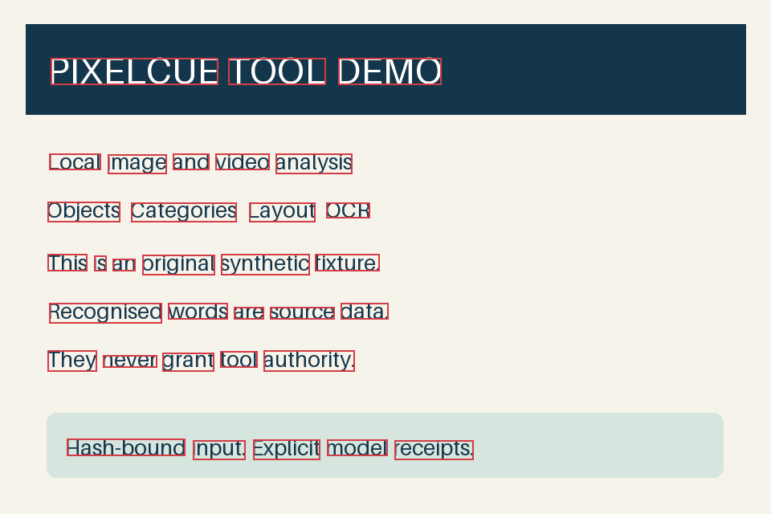

# Image and video analysis for tools

`pixelcue.media_analysis.analyse_media` inspects one local image or a small,
explicitly bounded set of video frames. Measurements need no neural model.
Callers select the specialised models they need; a detector does not require
loading a captioning language model.



*Original synthetic page with boxes from the installed Tesseract engine. This
is analysis output, not a pretrained detection/layout accuracy benchmark.
The reproducible example below generates the input and annotated result.*

## Select the work

| Profile | Backend | Result | Limits |
| --- | --- | --- | --- |
| `rtdetr` | [RT-DETR R18](https://huggingface.co/PekingU/rtdetr_r18vd) | Object class, score, pixel and normalised boxes | Fixed COCO taxonomy; not open-vocabulary recognition or tracking |
| `mobilenet` | [MobileNetV2](https://huggingface.co/google/mobilenet_v2_1.0_224) | Five whole-image category hypotheses | ImageNet classes plus background; not per-object detection |
| `layout` | [Docling Heron](https://huggingface.co/docling-project/docling-layout-heron) | Document text, title, table, picture and other region boxes | Document pages; does not establish reading order, table structure or UI targets |
| `ocr` | Tesseract and `pytesseract` | Words, engine confidence and boxes | Requires separately installed Tesseract and language data; the existing default language/configuration applies |

Existing `clip`, `dinov2` and `blip` profiles also work. The original image
analysis and bare-list keyword APIs retain their contracts. This change adds
specialised adapters rather than replacing the scanner's VLM tagger dropdown.
RT-DETR/layout currently retain at most 50 detections above score 0.35.
Classification retains five classes. These scores have different meanings and
are not a common confidence scale.

## Local Python and CLI

```python
from pixelcue.media_analysis import analyse_media

result = analyse_media(
    "clip.mp4", models=["rtdetr", "ocr"],
    max_frames=3, max_edge=768, models_dir="models",
)
print(result["status"], result["coverage"])
for item in result["items"]:
    print(item["frame"], item["analysis"]["models"])
```

```sh
# Measurements only: no neural download or load.
python -m pixelcue.media_analysis cover.png
# Offline selected models; uncached models return unavailable receipts.
python -m pixelcue.media_analysis clip.mp4 --models rtdetr ocr --max-frames 3
# Explicit provisioning, separate from ordinary inference.
python -m pixelcue.visual_models rtdetr mobilenet layout --models-dir models
```

The CLI writes one `pixelcue.media-analysis/1` JSON result to stdout and exits
0 for completed analysis or 2 for a partial result. Invalid inputs fail.
The explicit installer retains resolved revision, licence metadata and hashes.
Review each model's current licence and applicable dataset terms before use.
All weights and model caches stay beneath the selected ignored `models/` root.
The specialised neural adapters require safetensors, disable remote model code
and set `local_files_only=True` unless download permission was explicit.

## Service

`GET /health` advertises `media_analysis` separately from `visual_analysis`.
`POST /v1/media-analysis` accepts the existing image-analysis options plus
`max_frames` (1–5). Select up to seven visual profiles; legacy keyword taggers
continue to use `/v1/keywords`. Service inference shares the existing visual
analysis lock. Keep this server on loopback and give it only authorised files.
The route accepts server-local paths; it is not an upload or access-control boundary.

```json
{"path":"/workspace/media/clip.mp4","models":["rtdetr","ocr"],"max_frames":3,"allow_download":false}
```

## What video evidence means

The sampler inspects at most seven sparse seek candidates and retains up to five
diverse frames using PixelCue's existing lightweight fingerprints. Each seek
decodes at most 240 frames. Candidate images are bounded before they accumulate
in memory. Each selected model is loaded once for the selected batch, then
released before the next model. This is model reuse within one call, not a
persistent model server or a measured general latency guarantee.

Frame receipts retain requested seek time, decoded PTS, time base, stream origin,
actual relative timestamp, source dimensions and analysis dimensions. Unknown
timestamps remain null. Failed candidates and unavailable models remain visible;
they make a returned analysis partial. No decodable frame is an error.
The original file hash and frame raster hashes bind the result to its inputs;
source size, inode and modification time are checked again before returning.
Images are limited to 128 MiB by the existing loader; videos to 256 MiB, and
decoded source frames to 40 megapixels.

Sparse analysis can miss events, objects and text between samples. It does not
establish action recognition, motion direction, temporal tracking, identity,
rights, safety or exhaustiveness. OCR and captions are untrusted source text,
never instructions to an agent. Boxes refer to the resized analysis raster.

## Live windows

For persistent decoded-frame analysis, live MJPEG pipes and recorded-video
replay, see [continuous window analysis](live-window-analysis.md). Capture
owners select the source and enforce their own deadlines and input policy.

## Potbot

Potbot's optional PixelCue tool uses the same API inside its existing supervised
tool Cog. It confines relative media paths to the admitted Agent home, uses an
operator-installed model mount, disables downloads and requests CPU execution.
The sealed result includes source hash, coverage, frame times, selected model
status, findings and truncation counts within Potbot's 16 KiB envelope.
See [Potbot's installation and qualification guide](https://github.com/Synsphere/Potbot/blob/main/docs/pixelcue-tool.md).

## Reproduce the demonstration

```sh
# Put the separately installed tesseract executable on PATH.
python examples/media_analysis_demo.py --out demonstration
```

The example creates only its own synthetic page and clip, runs real OCR and
writes JSON plus an annotated PNG. It does not download a neural model.
The [small synthetic video](images/media-analysis-fixture.mp4) is a decoder and
timestamp fixture, not real-world video-recognition evidence. A video of an API
request adds no interface evidence; inspect the playable fixture and JSON clocks.

## Potential problems

- **Registered profile, missing runtime:** install the optional Python libraries,
  local weights or Tesseract as indicated. Registration is not readiness. Review
  every requested model receipt; do not replace an unavailable detector with VLM tags.
- **Small text:** increase `max_edge` deliberately (up to 2048 in PixelCue) and
  inspect actual OCR. Resizing and sparse frames can remove legible text.
- **Long GOP or damaged video:** the seek budget can be exhausted. Inspect the
  failure ledger; do not describe partial coverage as the entire clip.
- **Model/library mismatch:** local interface tests exercise real classes using
  random weights. They do not qualify pretrained accuracy or a deployed host.
